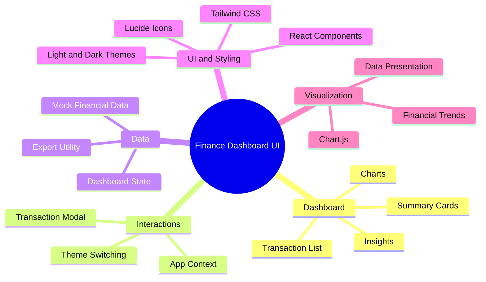
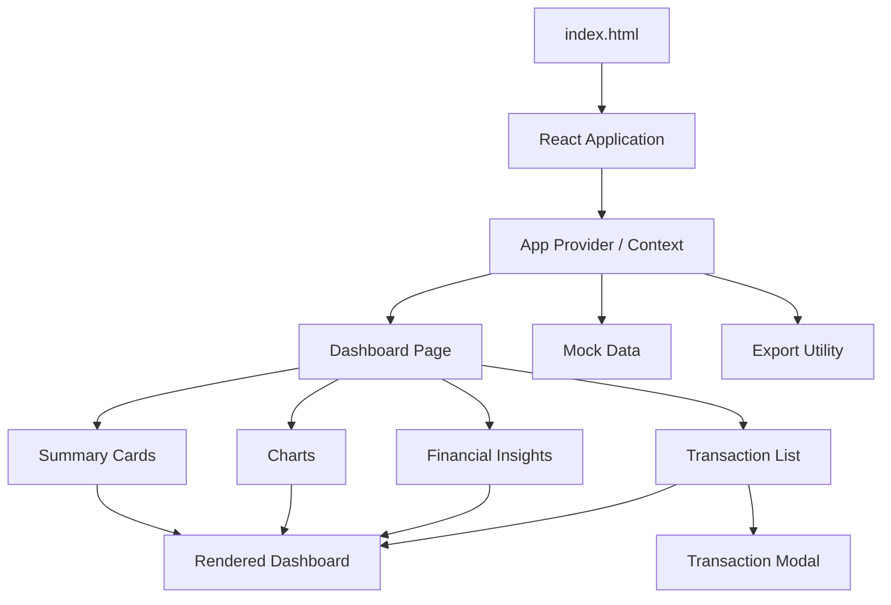
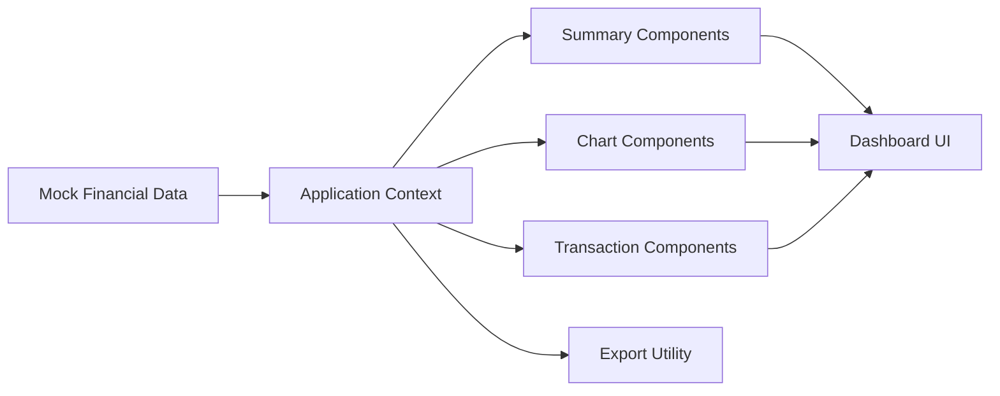

# Finance Dashboard UI 📊
### An Interactive Financial Dashboard Built with React

A clean, responsive finance dashboard interface designed to bring financial summaries, transaction records, charts, and insights into one place.

**Live Demo:** [View Finance Dashboard](https://finance-dashboard-ui-iota.vercel.app/)

**Source Code:** [Harinath125/Finance-Dashboard-UI](https://github.com/Harinath125/Finance-Dashboard-UI)

<p align="center">
  
  
  
  
  
</p>

---

## 📌 Overview

Finance Dashboard UI is a frontend project that organizes financial information into a dashboard-style interface. It uses React for component-based rendering, Tailwind CSS for styling, and Chart.js for visualizing financial data.

The application separates its interface into reusable components for charts, summary cards, insights, transaction records, and transaction-related interactions.

The repository includes mock financial data and a client-side export utility. It is designed as a frontend dashboard rather than a verified connection to a live banking or brokerage system.

## ✨ Features

- **Financial summary cards** — display key dashboard figures using reusable components.
- **Interactive charts** — visualize financial data with Chart.js.
- **Transaction list** — organize transaction records in a dedicated interface.
- **Transaction modal** — provide a dedicated interface for transaction-related actions.
- **Financial insights** — display dashboard insights through a separate component.
- **Light and dark themes** — support both visual themes through Tailwind CSS classes.
- **Export utility** — includes a client-side export module.
- **Reusable component structure** — keeps dashboard sections separated for easier maintenance.
- **Responsive styling** — uses Tailwind utility classes to support adaptable layouts.

The exact calculations and behaviors depend on the current application code and mock-data implementation.

## 🧠 Project Mind Map



## 🏗️ Application Architecture



### How it works

1. `index.html` loads React, React DOM, Babel, Tailwind CSS, Chart.js, and the application's scripts.
2. The application initializes its context provider and dashboard page.
3. Dashboard components use the application's data and state to render financial information.
4. Chart components present data visually.
5. Transaction components provide the interface for viewing and interacting with records.
6. The export utility supports client-side data export.

This describes the frontend architecture; the repository does not establish a live financial-data backend.

## 🛠️ Technology Stack

| Technology | Purpose |
|---|---|
| React 18 | Component-based UI and rendering |
| JavaScript / JSX | Application logic and components |
| Tailwind CSS | Styling, layout, and theme utilities |
| Chart.js 4 | Financial charts and data visualization |
| Lucide Icons | Interface iconography |
| React Context | Shared application state |
| Babel Standalone | Browser-side JSX transformation |
| Vercel | Live demo hosting |

The project loads several libraries directly from CDN URLs in `index.html`, so an internet connection is required for the current setup.

## 📂 Project Structure

```text
Finance-Dashboard-UI/
├── components/
│   ├── Charts.js
│   ├── SummaryCards.js
│   ├── Insights.js
│   ├── TransactionModal.js
│   ├── TransactionList.js
│   └── Layout.js
├── context/
│   └── AppContext.js
├── pages/
│   └── Dashboard.js
├── trickle/
├── utils/
│   ├── mockData.js
│   └── export.js
├── app.js
└── index.html
```

### Directory responsibilities

- `components/` — reusable dashboard sections and transaction interfaces.
- `context/` — shared application state and context.
- `pages/` — dashboard page composition.
- `utils/` — mock financial data and export-related logic.
- `app.js` — React application initialization and error boundary.
- `index.html` — HTML entry point, CDN dependencies, styling configuration, and script loading.

## ⚙️ Getting Started

### Prerequisites

- Git
- Python 3 or another local static web server
- A modern browser
- An internet connection for CDN-hosted dependencies

### 1. Clone the repository

```bash
git clone https://github.com/Harinath125/Finance-Dashboard-UI.git
cd Finance-Dashboard-UI
```

### 2. Start a local server

Using Python:

```bash
python3 -m http.server 8000
```

### 3. Open the dashboard

Visit:

```text
http://localhost:8000
```

The browser loads `index.html` and its referenced application scripts.

**Note:** The current repository uses browser-loaded dependencies rather than a conventional npm/Vite build workflow. Commands such as `npm install` or `npm run dev` should only be used if a package manifest and corresponding scripts are added.

## 📈 Data and Visualization Flow



The mock-data approach allows the UI to be explored without configuring a financial-data API. To use real financial information, the data layer would need to be connected to a suitable backend or authorized provider.

## 🔒 Data and Security Considerations

This project should not be treated as a production financial platform without additional engineering.

Before using real financial data:

- Replace mock data with a secure and documented data source.
- Implement server-side authentication and authorization if user accounts are introduced.
- Avoid storing sensitive financial information in publicly accessible frontend code.
- Validate and sanitize user-supplied data.
- Review how exported files handle sensitive information.
- Add error handling for failed data requests and invalid records.
- Test the application with realistic data and accessibility requirements.

## 🗺️ Future Improvements

- [ ] Add screenshots and a dashboard walkthrough.
- [ ] Introduce a documented build system such as Vite.
- [ ] Add unit and component tests.
- [ ] Add filters for transaction date, category, and amount.
- [ ] Document the available chart types and their data sources.
- [ ] Add pagination for larger transaction datasets.
- [ ] Introduce a secure backend integration for real financial data.
- [ ] Add accessibility checks and automated quality workflows.
- [ ] Document the export formats supported by the implementation.

These items are proposed enhancements, not claims about existing functionality.

## 🤝 Contributing

Contributions and suggestions are welcome.

1. Fork the repository.
2. Create a feature branch.
3. Make your changes.
4. Test the dashboard locally.
5. Submit a pull request with a clear description.

## 👨‍💻 Author

**Rayala Harinath**

GitHub: [@Harinath125](https://github.com/Harinath125)

---

<p align="center">
  <b>Finance Dashboard UI</b><br/>
  Turning financial information into a clear visual experience.
</p>
